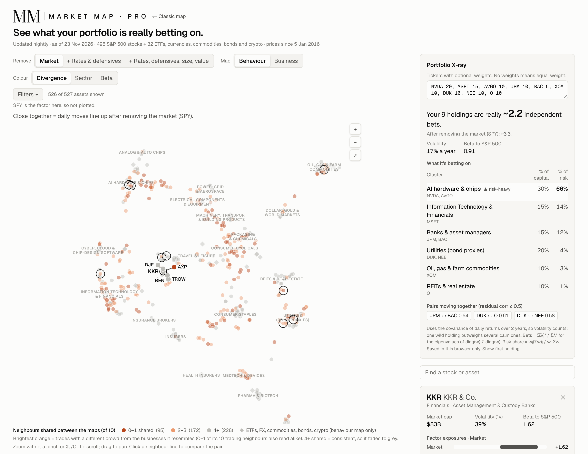

# Market Map

Which S&P 500 stocks secretly move together, and how many real bets does a portfolio actually hold?

**[Classic map](https://market-map-zeta.vercel.app/)** · **[Market Map Pro](https://market-map-zeta.vercel.app/pro)** · **[About](https://market-map-zeta.vercel.app/about)**

Built by Jaden Machado, a Grade 12 student, in November 2026.

*Example portfolio, data as of 23 Nov 2026: 9 holdings are really about 2.2 independent bets. Two chip stocks, NVDA and AVGO, are 30% of the money and 66% of the risk.*

## Why I built it

A friend showed me a map that recommends films by placing similar ones close together. I wondered whether the same idea worked for stocks: which companies trade alike, and when two lookalikes drift apart in price, do they come back together? That is pairs trading. I tested it on seven years of data and it failed, so I turned what I had already built into a risk tool.

The classic map is for people who have just started investing and want to see the idea. Pro is for people who already hold stocks: enter your positions and see what you are really betting on, and what would hedge it.

## What it does

- **Behaviour map:** stocks grouped by how their prices move once the whole market's swings are removed.
- **Business map:** stocks grouped by what the companies do, read from their own descriptions of the business (SEC 10-K filings in Pro).
- **Pro:** paste a portfolio and see how many independent bets it really holds, which positions carry the risk, and what would hedge each one.

## The test that failed

My first idea was a trade: when two similar businesses drift apart in price, bet that they come back together. I wrote down what would count as a pass before running anything, then tested it on data it had never seen, one year at a time, across 7 rolling folds from 2016 to 2026.

- **It didn't pay.** +0.8% a year (t = 0.1), which can't be told apart from zero. With 1-year look-back windows it **lost 8.8% a year**: the laggards kept lagging.
- **The prices didn't converge, but the link did.** Lookalikes that traded apart re-coupled: next-year correlation +0.08 beyond matched controls (t = 2.8).
- **Hidden twins are real.** Stocks that trade together kept about 70% of their extra correlation the following year.

So it is a tool for spotting concentration risk, not a source of trades.

## How it was built

AI coding agents wrote most of the code. The idea was mine, and so were the decisions: what to build, what "correct" meant, and checking the results. I tested the trading idea before trusting it, and when it failed I rebuilt the site around what the data did support. Pro now rebuilds itself after every US trading day from public data, and more than 90 automated tests check the maths.

## Limitations

- Prices come from Yahoo Finance, which is free data, not the professional feeds banks use.
- It uses today's S&P 500 members, so companies that dropped out of the index are missing. That survivorship bias flatters any backtest.
- Hedges are measured on the same two years they are fitted on, so real-world results will be weaker.
- It is not a trading signal.

## What's in the repo

| Path | What it is |
|---|---|
| `market_map.ipynb` | Classic map pipeline (Colab): prices → residual correlations → behaviour map; descriptions → embeddings → business map; exports `market_map.json`. |
| `oos_test.ipynb` | The out-of-sample test above, with the pass/fail rules set before the run. |
| `pipeline_v2.py` | Pro's data build: 10-K text, factor presets, portfolio X-ray, hedges, clusters. See [`PRO.md`](PRO.md). |
| `tests_v2/`, `web/tests-*` | Python and front-end tests. |
| `.github/workflows/pro-nightly.yml` | The nightly rebuild and deploy of Pro. |
| `web/` | Next.js front end (static). See [`web/README.md`](web/README.md). |

## Running it

**Classic map:** open `market_map.ipynb` in Colab and choose Runtime → Run all. The first run fetches about 500 company descriptions from Yahoo (about 8 minutes) and caches them in `desc_cache.json`. Then copy the export into the front end with `cd web && npm run sync-data`.

**Pro:** see [`PRO.md`](PRO.md). In short, `python pipeline_v2.py`, with `SEC_USER_AGENT` set to a contact address so SEC serves the 10-K filings.

Data: today's S&P 500 members, prices from Yahoo Finance via yfinance, business text from SEC EDGAR 10-K filings (Pro) and Yahoo (classic map). Not investment advice.
